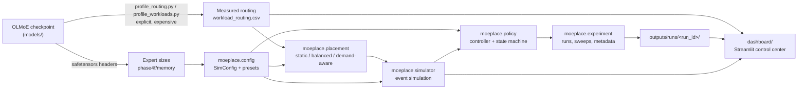
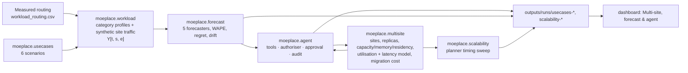

# Architecture

## `moeplace/` (no torch import anywhere)

| Module | Responsibility |
|---|---|
| `paths.py` | Absolute project-root paths (`MOE_PROJECT_ROOT` overrides) |
| `config.py` | `SimConfig` frozen dataclass: cluster, cost model, network, workload, migration, controller thresholds. `validate()` raises `ConfigError` with all problems. Model constants from `config.json`. `PRESETS` reproduce saved experiments. Units: GB/s, ms, bytes. |
| `data.py` | CSV loaders with required-column schemas; routing invariants (1,024 rows per request, top-8 sums); trace building; JSON-only model metadata |
| `placement.py` | `assign()` (three strategies, capacity-aware), `plan()`, per-GPU metrics (load proxy, slots, memory feasibility), moved-expert diff |
| `simulator.py` | `run()` discrete-event simulator (port of Phase 4D with optional tracing, shared-port network, byte memory budget, fault injection, Poisson arrivals); `run_batch_at_zero()` (4A); `migration_only()` (4B) |
| `policy.py` | `MigrationStateMachine` (proposed → approved/rejected → transferring → active/failed); `decide()` (train-only forecast + reasons); `evaluate()` (never / always / cost-aware on held-out) |
| `experiment.py` | `run_scenario()` and `sweep()` with deterministic run ids `name-<hash(config, routing sha256)>`, atomic writes, `metadata.json`, error capture |
| `registry.py` | Provenance (measured / checkpoint / derived / simulated) and parameters for every original output |
| `legacy.py` | Project-root `chdir` + overwrite guard used by the original scripts |

### Simulator event model

Events: `request_arrival`, `expert_start`, `expert_computed`, `expert_returned`, `approve_migration`,
`copy_start`, `copy_done`, ordered by (time, insertion serial). A request pins the active layout at arrival.
For each layer, every selected expert is dispatched gateway → GPU (link queue), computed (GPU FIFO queue,
`n × compute_ms / speed`), and returned (link queue). The next layer starts when all returned. At approval, the
staging check (resident + incoming ≤ staging slots, optional byte budget) runs, then all copies are queued on
the same link queues as inference. Activation is atomic when the last copy lands; a failed copy rolls back.

## Multi-site extension (feedback response)

| Module | Responsibility |
|---|---|
| `multisite.py` | `Site`, `Device`, `CostModel`, `Constraints`, `Topology`; `plan_sites()` greedy min-bottleneck placement with residency copies, budgeted replicas, hysteresis; `evaluate()` utilisation/latency/residency; `migration_cost()`; `exact_small()` brute force for tiny instances |
| `workload.py` | Measured per-category routing profiles; synthetic site traffic (daily cycle by time zone, mixes, shifts) → Y[t, s, e] |
| `forecast.py` | naive, seasonal-naive, EWMA, site-aware EWMA, global EWMA; WAPE, popularity and volume error; placement regret; drift table |
| `usecases.py` | Six use cases with users, KPIs, governance focus, topology, traffic, events |
| `agent.py` | `PlacementAgent` (tools with permissions, state, learning on regret), `Authoriser`, approval hook, explainer hook |
| `scalability.py` | One-factor-at-a-time timing sweep, growth fits, optimality gap |

## Dashboard

`dashboard/app.py` (entry) → `st.navigation` → `dashboard/app_pages/*.py`. Shared code in `dashboard/ui.py`:
Plotly dark template, provenance badges, `st.cache_data` loaders and cached simulations keyed by the full
config JSON. Theme: `dashboard/.streamlit/config.toml` (script-level config, applies from any launch directory).

The pages follow one story, numbered in the sidebar. Every page opens with an "About this page" box
(what it shows, how to read it, key takeaway; `ui.explain`) and ends with previous/next links (`ui.step_footer`,
order in `ui.STORY`). Simulation settings sit in a collapsed "Change the simulated setup" panel.

| Sidebar section | Page (file) | Data |
|---|---|---|
| — | Start here (`start.py`, default) | five-step plain-language story from saved files |
| — | Presentation mode (`demo.py`) | 10-step guided demo, saved files only |
| — | Ask the assistant (`assistant_chat.py`) | offline Q&A engine `dashboard/assistant.py` (topic + glossary matching, live facts from `ui.assistant_facts`); also a sidebar quick-ask popover |
| Part 1 · real data | 1. What is inside the model? (`model.py`) | config.json, index.json, phase4f/memory |
| Part 1 · real data | 2. Which experts are busy? (`routing.py`) | workload_routing / timings (+ new measurement runs) |
| Part 2 · simulation | 3. Where should experts go? (`placement.py`) | live placement under the session scenario |
| Part 2 · simulation | 4. How fast would requests run? (`inference.py`) | live event simulation with traces |
| Part 3 · simulation | 5. Should we move experts? (`migration.py`) | live controller + session-only sandbox |
| Part 3 · simulation | 6. Does network speed matter? (`network.py`) | saved Phase 4F + optional live fine sweep |
| Part 4 · results | 7. All results side by side (`evaluation.py`) | saved, or live re-simulation |
| Part 4 · results | 8. What we learned and the limits (`findings.py`) | numbers read from saved CSVs |
| Advanced & reference | Multi-site, forecasting & agent (`multisite.py`) | six tabs (use cases, forecasting, regret & drift, agent, scalability, governance); view models in `dashboard/ms_views.py`; saved `usecases-*` / `scalability-*` runs plus in-memory runs on button press; governance tables parsed from `docs/GOVERNANCE.md` |
| Advanced & reference | Technical summary (`overview.py`) | saved + one cached live decision |
| Advanced & reference | Where the data comes from (`provenance.py`) | registry, outputs/runs, outputs/measurements |
| Advanced & reference | Glossary (`glossary.py`) | static term list |

A session-wide **scenario** (`st.session_state["scenario"]`, a validated `SimConfig`) is edited on the planner,
inference and migration pages and shown in the sidebar. The migration sandbox keeps its own state machine and
event log in session state; it never writes files.
