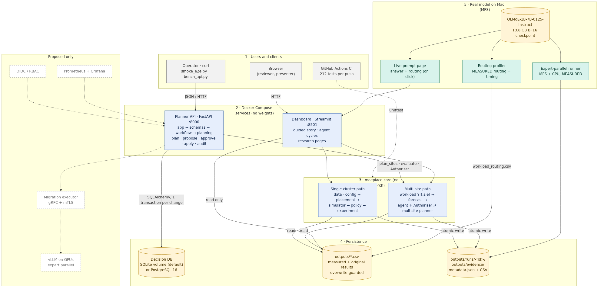

# 1. Executive summary

**Objective.** Mixture-of-Experts (MoE) models send each token to a few of many expert networks. When experts are
spread over devices or sites, *where* each expert lives decides how evenly the devices are loaded, how much data
crosses the network, and whether a data-residency rule is respected. The project asked: *under which workload,
hardware and network conditions does demand-aware placement help, and when is moving or replicating experts worth
its cost?*

**Implemented solution.** A Python system with five integrated parts:

1. **Real measurement** of expert routing on `allenai/OLMoE-1B-7B-0125-Instruct` (16 layers × 64 experts, top-8 →
   1,024 experts) on Apple MPS, plus checkpoint-derived expert sizes (12,582,912 bytes each).
2. **`moeplace` core library** (3,039 lines, no PyTorch): placement algorithms, a discrete-event simulator of a
   heterogeneous 4-GPU cluster, a cost-aware migration controller, a multi-site planner with replicas and residency,
   five demand forecasters with placement-regret metrics, and a rule-governed operations agent.
3. **Planner API** (FastAPI, `service/`) with a transactional decision database (SQLite or PostgreSQL) implementing
   the plan → propose → approve → apply → audit lifecycle.
4. **Streamlit dashboard** for guided demonstration, live prompts on the real model, and interactive agent cycles.
5. **Reproducible packaging**: pinned dependencies, Docker Compose, GitHub Actions CI, and an evidence pipeline.

**Major outcomes** (simulated hardware unless stated):

| Result | Value |
|---|---|
| Held-out peak-load reduction, demand-aware vs static | **−29.4 %**; beats all 10,000 random placements; 5.6 % above the theoretical lower bound |
| Same, on 18 new prompts never used for planning (measured routing) | **−29.8 %**; beats all 10,000 random placements; −28.4 % on average over 1,000 random 24-prompt splits, better in every split |
| Migrating 776 experts (9.76 GB) at 12 GB/s, 30 seeded scenarios | held-out p95 **worse** by 13.7 % (95 % CI −19.9 to −7.5) |
| Same at 100 GB/s | p95 **better** by 6.4 % (95 % CI 3.2 to 9.6) |
| Operations agent vs never-re-planned plan, device failure | objective 442 vs 1,371; max utilisation 0.77 vs 1.19 |
| Residency violations in the regulated use case | **0** |
| Planner wall time (measured) | 0.34 ms at proposal size; 272 ms at 16,384 experts |
| Planner API (measured, Docker) | `POST /proposals` p50 16.8 ms, p95 18.5 ms |
| Automated tests | **218 passing** locally and in Docker (CI repeats them on every push); 14/14 end-to-end API checks on SQLite and PostgreSQL |

**What is not real.** Routing and expert sizes are real; every GPU speed, network link, queue and migration is a
simulation with stated assumptions. The system never moves weights between real GPUs: `apply` activates a plan in
the database. No result here is a measured multi-GPU speed-up.

# 2. Proposal alignment

The full matrix, with evidence for each row, is in `docs/TRACEABILITY.md`. Summary:

| Area | Proposed | Delivered |
|---|---|---|
| O1 Data | keep 6 prompts; add ≥ 100; 60/20/20 split | 6 prompts kept with schema checks; 24-prompt set profiled (18 new) and used to re-test placement. ≥ 100 not reached. |
| O2 Placement | 4 strategies on held-out demand; 10 % target | Completed; −29.4 %, and −29.8 % on 18 unseen prompts; random-baseline and lower-bound comparisons |
| O3 Operations | 3 migration policies; 6 use cases; blocked infeasible moves; approvals | Completed in simulation, plus 30-seed replicates with confidence intervals |
| O4 Scale + forecasting | 16–16,384 experts, 3–96 devices, 1–8 sites; 5 forecasters; regret | Completed |
| O5 Reproducibility | dashboard, CLI, tests, CI, container | Completed; the container (listed as "not yet implemented" in the proposal) was added in this phase |

**Deviations and justifications.**

* *API shape* — paths are `/plan` and `/proposals/{id}/approve` instead of `/v1/placements:plan`. With a single
  API version a prefix adds nothing; it is a one-line router change when a v2 appears. Idempotency keys and 409
  conflict semantics were implemented as designed.
* *Database* — SQLite is the default so a reviewer needs no database server; PostgreSQL is supported through the same
  SQLAlchemy models and was verified end-to-end in Docker during this phase.
* *Scheduled worker* — agent cycles are started by a person (dashboard button or API call). This was already stated
  in the proposal and avoids an unattended process changing state during a demo.

**Not implemented, with impact.**

* *≥ 100 additional prompts.* A 24-prompt set (231 tokens, 8 per category; 18 new prompts) was profiled at the end
  of this phase (`outputs/measurements/routing-20261110T123026Z/`) and used to re-test placement (section 5), but the 100-prompt target was not reached. The
  migration, controller and agent results still rest on the original 6 prompts (44 tokens), where 15 % of experts were never
  selected. Held-out p95 over three requests equals roughly the maximum. Results show the method works; they do not
  generalise statistically.
* *Authentication (OIDC roles).* The API must stay on localhost; approver identity is self-declared.
* *Migration executor, vLLM serving, Prometheus/Grafana.* Need multi-GPU hardware; deferred (architecture ADR-6).

# 3. System architecture

Source: `docs/figures/architecture_implemented.mmd` (rendered with mermaid-cli). Compared with the architecture
document's Figure 2, the planner API, decision database and Docker Compose control plane are now implemented; the
executor, serving engine, identity provider and monitoring stack remain proposed.

**Component responsibilities and interfaces.**

| Layer | Component | Responsibility | Interface |
|---|---|---|---|
| Real model | `scripts/profile_routing.py` | Run OLMoE forward passes, record top-8 router choices per token and layer | writes `workload_routing.csv` (fixed schema) |
| Real model | `dashboard/live_model.py` | Generate an answer and route a user's prompt on demand | called by one dashboard page; holds an inference lock |
| Core | `data`, `config` | Load CSVs with schema checks; validate configuration | `load_routing()`, `SimConfig.validate()` → `ConfigError` |
| Core | `placement` | Assign experts to devices | `assign(demand, strategy, speeds, slots)` |
| Core | `simulator` | Event simulation of requests and copies | `run(cfg, placements, …)` → per-request latency, traces |
| Core | `policy` | Decide whether to migrate; state machine | `decide()`, `MigrationStateMachine` |
| Core | `workload`, `forecast` | Build Y[t, s, e]; forecast; regret; drift | forecaster objects with `fit/predict` |
| Core | `multisite` | Place experts and replicas over sites under constraints | `plan_sites()`, `evaluate()`, `migration_cost()` |
| Core | `agent` | Observe → forecast → propose → check → approve → act → learn | `PlacementAgent`, `Authoriser.check()` |
| Service | `service/app.py` | HTTP routes, error contract, request IDs | REST/JSON, OpenAPI at `/docs` |
| Service | `service/workflow.py` | Proposal lifecycle; one transaction per change | Python, raises `Conflict`/`NotFound` |
| Service | `service/planning.py` | Adapter: scenario → topology + measured demand → `plan_sites` | no database access |
| Storage | `service/db.py` | Plans, proposals, approvals, audit events | SQLAlchemy; DB invariants |
| UI | `dashboard/` | Presentation and research pages | reads `outputs/`, calls `moeplace` |

**Integration and data flow.** The routing profiler is the only component that writes measured data. Everything
downstream reads it through `moeplace.data` with schema validation. The API and the dashboard call the *same*
`moeplace` functions — the API's approval rules are the agent's `Authoriser`, not a copy — so the two cannot
disagree. Experiment outputs go to `outputs/runs/<name>-<hash>/` with `metadata.json`; the hash covers the full
configuration and the routing file's SHA-256, so a changed input can never reuse an old result.

**Separation of concerns.** `moeplace` never imports PyTorch (a test asserts it), which keeps CI, Docker and the
dashboard light (995 MB image, no 13.8 GB checkpoint). Each `service/` module has a stated "does not" (e.g.
`planning.py` never touches the database; `app.py` contains no business rules) — see `docs/SERVICE.md`.

# 4. Implementation details

**Technologies.** Python 3.11; numpy/pandas for computation; PyTorch 2.14 + transformers 4.57 for the model (host
only); Streamlit 1.66 + Plotly for the UI; FastAPI + pydantic 2 + SQLAlchemy 2.1 for the service; SQLite/PostgreSQL
16; Docker Compose; GitHub Actions. All versions are pinned in `requirements*.txt`.

**Routing measurement.** One forward pass per prompt with `output_router_logits=True`; per layer the top-8 of 64
router logits per token are counted per (request, layer, expert). Invariant: each (request, layer) sums to
tokens × 8 (checked on load).

**Demand-aware placement.** Experts are processed from most to least demanded; each goes to the device with free
slots that minimises (current load + demand) ÷ speed. Static (round-robin) and speed-blind balancing are the
baselines. A random baseline draws 10,000 capacity-feasible layouts; the lower bound splits work exactly in
proportion to speed, ignoring slot limits. Placement uses training requests (0, 2, 4) only; tests corrupt the
held-out routing and confirm placements do not change.

**Discrete-event simulator.** Events (arrival, expert start/compute/return, approval, copy start/done) are ordered
by (time, insertion serial) for determinism. Each GPU and each directed link is a FIFO queue. A request pins the
layout active at its arrival; layer L+1 starts only when every expert of layer L has returned. Migration copies
share the links with inference. New weights are staged while old ones stay resident; activation is atomic when the
last copy lands; an injected copy failure rolls back to the old layout.

**Cost-aware controller.** Approves only if staging fits, forecast makespan gain ≥ 2 %, and forecast p95 regression
≤ 0 %, using training requests only.

**Multi-site planner and agent.** Three simulated sites (Abu Dhabi, Frankfurt, Singapore), 4 devices each,
1.25 GB/s and 60 ms between sites. Synthetic site traffic follows each region's daily cycle and prompt mix, built
from measured per-category routing profiles. The agent runs hourly: it refits its forecaster when *realised
placement regret* exceeds 2 % (not when forecast error is high, because the two correlate weakly), proposes a plan
with hysteresis, and passes it to the deterministic Authoriser (capacity, memory, residency, utilisation < 1,
minimum gain, migration time budget, human approval above 50 GB or for residency sites).

**Planner API and database.**

| Endpoint | Purpose |
|---|---|
| `GET /health` | DB and routing data reachable, else 503 |
| `POST /plan` | what-if plan, stores nothing |
| `POST /proposals` | plan vs active plan → `ready` / `awaiting_approval` / `rejected` |
| `POST /proposals/{id}/approve` · `/deny` | human decision |
| `POST /proposals/{id}/apply` | activate; 409 if the active plan changed since assessment |
| `GET /plans/active`, `/plans/{id}`, `/proposals`, `/audit` | read state and audit log |

Each state change is one transaction (proposal + plan + audit events, or nothing). The database enforces one
active plan (partial unique index), one approval per proposal (unique), and status values (CHECK).

**Key engineering decisions.**

| Decision | Alternative | Reason |
|---|---|---|
| OLMoE as reference model | Mixtral, synthetic router | 64 experts/layer gives a real placement problem; runs on a laptop |
| Simulator before GPUs | rent GPUs first | no multi-GPU access; queues and copy contention must be understood first |
| Deterministic Authoriser; no LLM decides | LLM agent | auditable, testable; no prompt-injection path to infrastructure |
| Greedy heuristic planner | ILP solver | 272 ms at 16,384 experts; matched exhaustive optimum on 20/20 tiny instances |
| SQLite default, PostgreSQL by URL | PostgreSQL only | zero-setup review; same models and constraints |
| Pure-Python core | one package with torch | fast CI and small container; model only loaded where needed |

**Error handling, logging, configuration, security.** Validation raises typed errors (`ConfigError`,
`SchemaError`) listing every problem, not bare `assert`. The API maps errors to 404/409/422/503 with a JSON
envelope; unexpected errors return 500 with the request ID that is also logged. Configuration comes from `MOE_*`
environment variables (`service/settings.py`) and the validated `SimConfig`; no paths or credentials are
hard-coded. The repository contains no secrets; the PostgreSQL password is read from the environment. The container
runs as an unprivileged user. Original result files are protected by an overwrite guard.

# 5. Testing and evaluation

**Methodology.** `python -m unittest discover -s tests -t .` (stdlib, no pytest dependency). The same command runs
locally, in the Docker image and on GitHub Actions for every push. `scripts/collect_evidence.py` runs the suite
with per-test timing and writes `outputs/evidence/` (all tables below are copied from `EVIDENCE.md`).

| Level | Tests | Failure/negative cases | Examples |
|---|---|---|---|
| Unit | 99 | 18 | placement capacity, simulator invariants (layer barrier, pinning, atomic activation), forecaster causality, schema errors |
| Integration | 24 | 9 | experiment runner + run ids, agent with planner + Authoriser, live-model adapter (mocked torch) |
| Regression | 15 | 1 | every saved simulated CSV regenerated bit-for-bit; 24-prompt evaluation and re-profiled routing pinned |
| API + DB integration / end-to-end | 27 | 10 | lifecycle, stale 409, idempotency, rollback on failure, 422 inputs, 503 when data missing |
| UI end-to-end (Streamlit AppTest) | 53 | 14 | every page renders; buttons; approval flow; no file writes (hash check); no torch import |
| **Total** | **218** | **52** | all pass, 25.2 s |

**End-to-end against the deployed containers.** `scripts/smoke_e2e.py` drives the operator workflow over real HTTP
against the Docker image: health → what-if plan (no writes) → initial proposal → apply → device failure → restore →
apply → stale proposal (409) → invalid input (422) → unknown id (404) → approve-after-apply (409) → audit
completeness. **14/14 checks passed on SQLite and 14/14 on PostgreSQL 16**, each in 0.18 s.

**Placement quality (held-out demand).**

| Strategy | Peak load | vs static | Beats random |
|---|---|---|---|
| Static | 896.3 | — | 35.8 % |
| Load-balanced (speed-blind) | 868.8 | −3.1 % | 57.2 % |
| **Demand-aware** | **632.5** | **−29.4 %** | **100 %** |
| Best of 10,000 random | 716.3 | | |
| Hindsight (uses test demand) | 599.4 | | |
| Lower bound | 599.1 | | |

Interpretation: exceeds the 10 % target and is 5.6 % from the bound. It is a load proxy with assumed GPU speeds,
not latency.

**The same evaluation on 24 measured prompts** (`outputs/runs/extended_prompts-5e1b709690/`, `scripts/evaluate_extended_prompts.py`). The 24-prompt
profiling run re-measured the original six prompts with **identical routing** (all 6,144 rows), so measurement is
deterministic, and added 18 new prompts. Only 1.8 % of experts are unobserved (15 % with six prompts).

| Evaluation | Demand-aware vs static | vs load-balanced | Notes |
|---|---|---|---|
| Original split on the new file (sanity) | −29.4 % | −27.2 % | reproduces the published result exactly |
| **Plan on the original 6, test on the 18 new prompts** | **−29.8 %** | −27.4 % | beats 100 % of 10,000 random layouts; 5.7 % above the bound |
| 1,000 random 50/50 splits, stratified by category | −28.4 % (2.5–97.5 %: −31.2 to −25.3) | −26.5 % | better than both baselines in every split |
| Learning curve, 1 → 6 training prompts per category | −25.6 % → −28.9 % | | gain grows with training data, then levels off |

So the placement gain is not an artefact of three test prompts: it holds on prompts the planner never saw. The split
range describes variation across splits that share prompts, not an independent confidence interval.

**Migration under 30 seeded Poisson scenarios** (5 req/s, seeds 0–29, 776 experts / 9.76 GB copied):

| Bandwidth | Held-out p95 gain of migrating (95 % CI) | Scenarios where it helps | Controller approved | Decision accuracy |
|---|---|---|---|---|
| 12 GB/s | −13.7 % (−19.9, −7.5) | 7 / 30 | 0 | 76.7 % |
| 100 GB/s | +6.4 % (+3.2, +9.6) | 17 / 30 | 12 | 70.0 % |

Interpretation: below roughly 15–25 GB/s the copy traffic competes with inference and migration hurts tail latency;
at 100 GB/s it helps on average. The controller is conservative at 12 GB/s (it correctly rejects in 23 of 30 cases)
and approves only 12 of the 17 beneficial cases at 100 GB/s. Its forecast uses three training requests, which is
the main reason for misclassification. These are replays of the same six traces, not independent measurements.

**Operations agent (six use cases, 47 hourly decisions each; lower objective is better).**

| Use case | Agent | Static plan | Oracle | Note |
|---|---|---|---|---|
| UC1 multi-region | 174 | 319 | 136 | 24 re-plans |
| UC2 residency | 254 | 299 | 242 | 0 violations; 13 approvals |
| UC3 single cluster | 0.50 | 0.50 | 0.50 | nothing to gain |
| UC4 workload shift | 532 | 1,086 | 432 | static overloads (1.11) |
| UC5 device failure | 442 | 1,371 | 384 | static overloads (1.19) |
| UC6 consolidation | 402 | 319 | 342 | 63 GPU-hours released at a latency cost |

Site-aware forecasting cut the expert-popularity error from 0.048 (one global vector) to 0.004. In UC1, 15 of 47
decisions had harmful regret despite low forecast error, which supports triggering refits on regret.

**Performance.** Planner wall time grows about linearly with experts (k = 0.94) and sites (k = 0.92) and is flat in
devices (k = 0.03): 272 ms at 16,384 experts, far below the 90 s target. API in Docker, n = 50 sequential calls:

| Endpoint | p50 | p95 | Throughput |
|---|---|---|---|
| `GET /health` | 1.5 ms | 1.8 ms | 660 req/s |
| `POST /plan` | 11.3 ms | 12.5 ms | 88 req/s |
| `POST /proposals` | 16.8 ms | 18.5 ms | 58 req/s |
| `GET /audit?limit=200` | 2.8 ms | 4.0 ms | 340 req/s |

**Real model evidence.** OLMoE forward passes on MPS take 12–22 s per prompt in FP32 eager mode (request 0, 52 s,
includes warm-up). A two-device expert-parallel smoke run (MPS + CPU, BF16) produced logits identical to the
single-device model on all six prompts (max difference 0.0), confirming the expert split is functionally correct.
Its latencies (static 200–220 ms, demand-aware 279–334 ms per prompt) show that on a fast GPU + slow CPU pair the
cross-device overhead dominates; this is one repeat on unrepresentative hardware and is not a placement result.

**Known failures and limits found by testing.** The controller rejects at all bandwidths in the original
fixed-arrival scenario (finding S14 in `docs/PROJECT_AUDIT.md`); the simulator is non-work-conserving (pessimistic
under load); aborted copies keep their reserved link time; old weights are never freed after activation.

# 6. Deployment

| Mode | Command | What runs |
|---|---|---|
| Local, full | `.venv/bin/streamlit run dashboard/app.py` | dashboard incl. live model page |
| Local API | `.venv/bin/uvicorn service.app:create_app --factory --port 8000` | API + SQLite in `data/` |
| Docker | `docker compose up --build` | API :8000 + dashboard :8501 |
| Docker + PostgreSQL | `docker compose --profile postgres up --build db api-pg` | API :8001 on PostgreSQL 16 |
| Docker tests | `docker compose --profile test run --rm tests` | 218 tests in the image |

**Configuration.** `MOE_DATABASE_URL`, `MOE_LOG_LEVEL`, `MOE_APPROVAL_GB`, `MOE_MIN_GAIN`,
`MOE_MAX_MIGRATION_FRACTION`, `MOE_STICKINESS`, `MOE_PG_PASSWORD`, `MOE_DASHBOARD_PORT`, `MOE_PROJECT_ROOT`.

**External dependencies.** No API keys, cloud services or GPUs are required. The 13.8 GB OLMoE checkpoint is needed
only for live prompts and new profiling (download once from Hugging Face; not in git or the image). Live inference
needs about 15 GB of free memory.

# 7. AI-assisted development

Declared in full in `docs/AI_USAGE_AND_CONTRIBUTIONS.md`. In short: AI coding assistants (including Claude Code)
were used to draft modules, tests, documentation and refactors. Every generated change was run against the test
suite; reproduction tests guaranteed that refactoring did not alter any original result; and several generated
claims were corrected after checking (e.g. bandwidth units in GB/s, a stale "hypothetical" comment on a value that
was in fact checkpoint-derived, a dashboard that labelled load proxies as utilisation). In this phase, the
evidence pipeline itself caught a generated mistake: new evidence CSVs failed the provenance test until the folder
was registered.

# 8. Limitations and future improvements

| Limitation | Effect | Next step |
|---|---|---|
| 24 prompts for placement, 6 for migration and agent results; prefill only | placement holds on 18 unseen prompts, but the other results do not generalise statistically; decode routing missing | reach ≥ 100 prompts with decode; re-run migration and agent experiments on them |
| All hardware simulated | absolute latencies are not predictions | calibrate on 4 × A100 (`docs/FUTURE_GPU_VALIDATION.md`) |
| Synthetic site traffic | multi-site results depend on assumed cycles and mixes | shadow mode on real telemetry |
| Controller forecast from 3 requests | 70–77 % decision accuracy | rolling window, expected-cost rule |
| No authentication | API is localhost-only | OIDC proxy; approver from identity |
| `apply` changes DB only | no real migration | executor with checksums and rollback |
| No metrics endpoint | limited observability | Prometheus `/metrics` |
| Analytic multi-site latency model | experts treated as independently remote; counts network round trips only, not queueing, so an overloaded plan (e.g. the static plan in UC4/UC5) looks faster than it would be | validate against the event simulator |

Trade-offs accepted: a heuristic over an exact solver (speed, explainability); conservatism over risky migration;
local-first simplicity over a distributed deployment that could not be tested.

# 9. Individual contributions

This is an individual project. Ayesha Alzaabi is responsible for every component: problem definition, proposal and
architecture; model profiling; placement, simulation, policy, forecasting, multi-site planner and agent; the
planner API and database; the dashboard; tests, CI and Docker packaging; experiments and this report. Evidence: the
git history of `github.com/aaalzaabi/moe-expert-placement` (all commits authored by her) and the saved runs under
`outputs/`.
