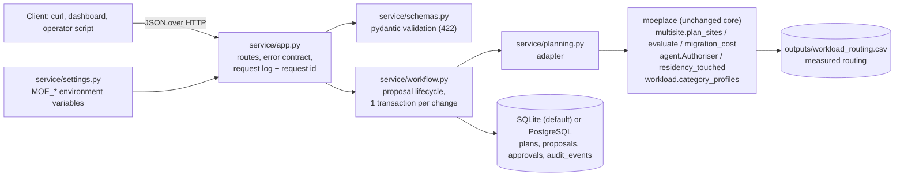
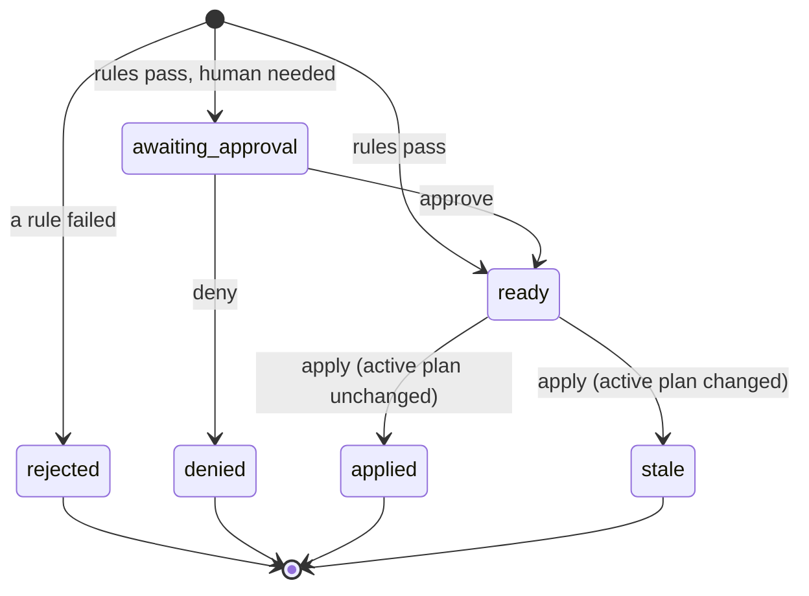

# Planner service (API + database)

`service/` makes the planner usable by other systems: a REST API that plans, proposes, approves and applies expert
placements, with every decision stored in a database and an append-only audit log. It implements the
"planner API (plan, propose)" and the "decision / approval / audit persistence" of the architecture document.

**Real vs hypothetical.** Expert-routing profiles come from MEASURED OLMoE routing (`outputs/workload_routing.csv`).
Device speeds, slots, network bandwidth and latency are HYPOTHETICAL inputs of the request, and all utilisation and
latency numbers come from the analytic cost model (`moeplace/multisite.py`). "Apply" makes a plan the active plan
**in the database**; it does not copy weights between real GPUs (no serving engine is connected).

## Components

| Module | Responsibility | Does not |
|---|---|---|
| `settings.py` | read and validate `MOE_*` environment variables | hold secrets or defaults for credentials |
| `schemas.py` | request/response models; reject bad input (types, ranges, unique names, unknown fields) | know about the planner |
| `planning.py` | scenario → topology + measured demand → `plan_sites` → metrics; authoriser verdict | touch the database |
| `workflow.py` | state machine and transactions; audit events | do HTTP |
| `db.py` | tables and database-level invariants | contain business rules beyond invariants |
| `app.py` | routes, HTTP status codes, logging middleware | contain business logic |

The planner and the authoriser are **reused**, not re-implemented: the API applies exactly the rules the simulated
operations agent applies (`moeplace/agent.py`), with the same default thresholds.

## Proposal lifecycle

Authoriser rules (from `moeplace.agent.Authoriser`):
* no capacity / memory / residency violation; predicted bottleneck utilisation < 1;
* `initial` (no active plan) and `restore` (a device of the active plan is gone) are mandatory changes;
* a `rebalance` must improve the objective by ≥ `MOE_MIN_GAIN` (2 %) and its transfer must fit in
  `MOE_MAX_MIGRATION_FRACTION` (5 %) of the 1-hour horizon;
* a human is needed if the migration moves more than `MOE_APPROVAL_GB` (50 GB) or touches a residency site.

The current plan is scored on the **new** scenario's hardware (devices matched by name), so a device that became
slower makes the current plan look as bad as it really is.

## Transaction boundaries

| Operation | One transaction writes | Locks / guarantees |
|---|---|---|
| `POST /proposals` | candidate plan + proposal + `proposal_created` + verdict event | active plan row `FOR UPDATE`; idempotency key unique |
| `POST /proposals/{id}/approve` or `/deny` | approval + proposal status + `human_*` event | proposal row `FOR UPDATE`; one approval per proposal (unique) |
| `POST /proposals/{id}/apply` | old plan → superseded, new plan → active, proposal → applied, `plan_activated` | proposal + active plan `FOR UPDATE`; partial unique index: one active plan |
| `apply` on a stale proposal | proposal → stale + `proposal_stale` (then HTTP 409) | same |

If any step fails, the transaction rolls back and nothing is written (tested: a failed request leaves no proposal
and no audit event). Full DDL: `docs/database_schema.sql`, generated from `service/db.py` by
`scripts/export_schema.py` (a test fails if it is out of date).

## Error contract

| Status | When |
|---|---|
| 404 | unknown proposal or plan; no active plan yet |
| 409 | wrong status for the action, stale proposal, Idempotency-Key reused with a different scenario, concurrent conflict |
| 422 | invalid input, or a scenario that cannot be served (not enough slots, residency infeasible, unknown category, different sites than the active plan) |
| 503 | database or measured routing data unavailable (`/health`) |
| 500 | unexpected error: logged with the request id, which is also returned in `X-Request-ID` |

## Design decisions and trade-offs

| Decision | Why | Trade-off |
|---|---|---|
| FastAPI + pydantic | typed validation and generated OpenAPI docs (`/docs`) with little code | another dependency |
| SQLAlchemy, SQLite by default, PostgreSQL by URL | zero-setup for evaluators; same models and constraints on PostgreSQL | SQLite serialises writers (fine for one planner) |
| Invariants in the database (partial unique index, CHECK, FK, UNIQUE) | hold even if application code has a bug or two requests race | slightly more schema |
| Optimistic check on apply (`base_plan_id` must still be active) | a proposal's gain and migration cost are only valid against the plan it was assessed on | the client must re-propose after a 409 |
| Plans stored as JSON (hosts, primary, serve) | a plan is always read and written whole; ~50 KB for 1,024 experts | not queryable per expert in SQL |
| Planning runs inside the proposal transaction | the verdict is consistent with the active plan it was compared to | the active-plan lock is held ~15 ms |
| Deterministic authoriser, no LLM in the decision path | auditable, testable rules for changes to serving | less flexible than a learned policy |

## Measured performance

`scripts/bench_api.py` against `uvicorn` on the author's Mac (Apple M4 Max), SQLite, sequential requests from the
same machine, n = 50 after 3 warm-up calls, the three-site / 12-device scenario in `examples/scenario.json`:

| Endpoint | p50 | p95 | sequential throughput |
|---|---|---|---|
| `GET /health` | 0.8 ms | 1.0 ms | ~1,200 req/s |
| `POST /plan` | 10.6 ms | 12.3 ms | ~92 req/s |
| `POST /proposals` (against an active plan, writes 4 rows) | 15.7 ms | 20.1 ms | ~60 req/s |
| `GET /audit?limit=200` | 1.6 ms | 2.2 ms | ~440 req/s |
| `POST /plan` invalid → 422 | 0.8 ms | 1.1 ms | ~1,200 req/s |

These are measurements of the **planner service** (computation + database), not of model inference. Planning runs
hourly in the design, so ~16 ms per decision leaves a very large margin.

## Limitations

* **No authentication or authorisation.** The architecture specifies authenticated callers; the implementation
  does not have them yet. The `approver` name is self-declared, so the approval step records who claims to approve
  but cannot prove it. Before any real use: put the API behind an identity-aware proxy or add OAuth2 / API keys,
  and take the approver from the authenticated identity.
* No connection to a serving engine: `apply` changes the active plan in the database only.
* Changing the set of sites is rejected (it is a new deployment, not a re-placement).
* Demand in a request is the expected demand for the next horizon; the API does not run the forecaster itself.
* Tested on SQLite (in CI and locally); PostgreSQL is supported through the same models but was not run in the
  test suite.
